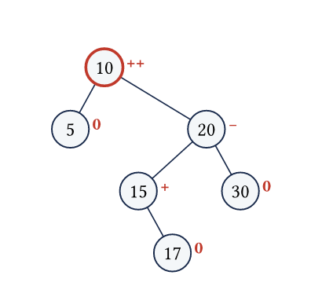
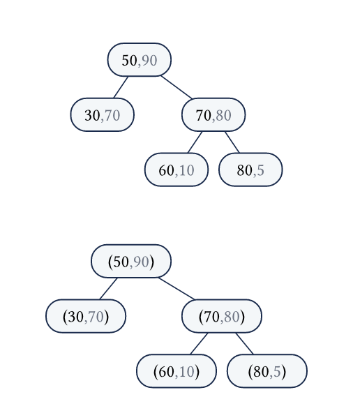
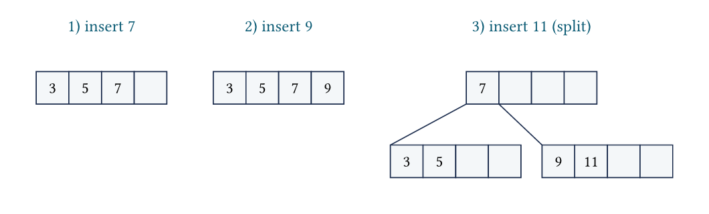
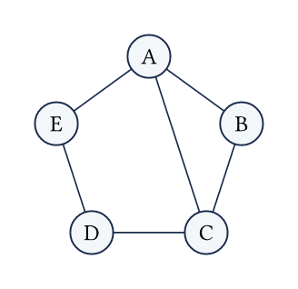
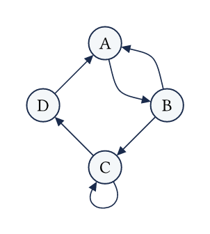
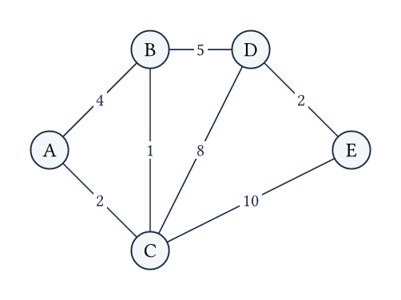
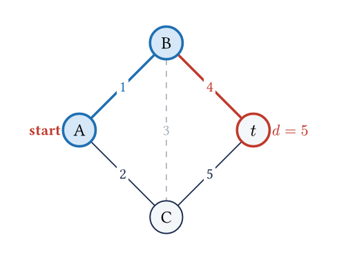
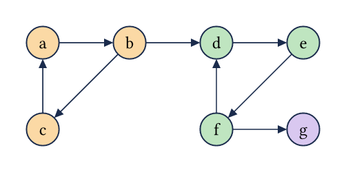
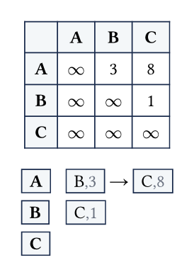

[](https://github.com/revo2123/sapling)
[](LICENSE)

# sapling
A small and simple Typst library for creating **computer science trees and graphs**.

## Features
- **Binary (Search) Trees**
- **AVL Trees** (with balance factors)
- **Heaps** (with optional indices)
- **Treaps** (with or without parenthesis)
- **B-Trees** (with anchor modes)
- **Graphs** (undirected, directed, weighted and mixed)
- **Adjacency matrices and lists**
- Marking and annotating nodes and edges
- Walkthroughs to show how a tree or graph changes, step by step

## Usage
```typ
#import "@preview/sapling:0.1.0": *

#binary-tree((8, (4, 2, 6), (12, none, 14)))
#avl-tree(bst-from((5, 3, 8, 1, 4)))
#heap((9, 7, 8, 3, 4))
#b-tree(((20,), (5, 10), (25, 30)), slots: 4)
#graph(("A", "B", "C"), (("A", "B", 3), ("B", "C", 1)), directed: true)
```

## Examples

### Binary trees
A node is `(label, left, right)`, and a leaf can be just its label. Use `none` for a missing child.

```typ
#binary-tree((8, (4, 2, 6), (12, none, 14)))
```


### Binary search trees
`bst-from` builds a tree by inserting the values one after another.

```typ
#binary-tree(bst-from((50, 30, 70, 20, 40, 60, 80)))
```


### AVL trees
`avl-tree` works like `binary-tree` and adds balance factors. Unbalanced nodes are red. Use `bf: "lr"` to flip the sign convention or `bf: none` to hide the factors.

```typ
#avl-tree(bst-from((10, 5, 20, 15, 30, 17)))
```



### Heaps
`heap` takes an array in level order. Use `indices: 0` or `indices: 1` to show the array index at each node.

```typ
#heap((1, 3, 2, 7, 4, 5, 6), indices: 1)
```


### Treaps
A node is `(key, priority, left, right)`. Use `parens: true` to show `(key,priority)`.

```typ
#treap((50, 90, (30, 70), (70, 80, (60, 10), (80, 5))))
#treap((50, 90, (30, 70), (70, 80, (60, 10), (80, 5))), parens: true)
```



### B-trees
A leaf is an array of keys, and an inner node is `(keys, child1, child2, ...)`. `slots` fixes the number of cells per node, and `anchor` sets where edges end on a child: `"left"` (default) or `"center"`.

```typ
#b-tree(((20, 40), (5, 10), (25, 30), (45, 50)), slots: 4)
#b-tree(((20, 40), (5, 10), (25, 30), (45, 50)), anchor: "center")
```


### Marking and annotating nodes
`marked` highlights keys in every tree type. For binary trees, `node` can also highlight a single node with `mark` or annotate it with `extra`.

```typ
#binary-tree(
  node(8, node(4, mark: true), node(12), extra: "root"),
  marked: (12,),
)
```


### Walkthroughs
Use `walkthrough` and `snapshot` to go through an entire solution. Each `snapshot` is one labelled state of a tree or graph, and `walkthrough` places them side by side. Use `columns` to continue in a new row after that many snapshots.

```typ
#walkthrough(
  snapshot("1) insert 7", b-tree((3, 5, 7), slots: 4)),
  snapshot("2) insert 9", b-tree((3, 5, 7, 9), slots: 4)),
  snapshot("3) insert 11 (split)", b-tree(((7,), (3, 5), (9, 11)), slots: 4)),
)
```



### Graphs
`graph` takes the vertices and the edges. A vertex is a string or an integer, and an edge is `(from, to)`. The vertices are placed on a circle, starting on top and going clockwise.

```typ
#graph(
  ("A", "B", "C", "D", "E"),
  (("A", "B"), ("B", "C"), ("C", "D"), ("D", "E"), ("E", "A"), ("A", "C")),
)
```



### Directed graphs
Use `directed: true` to draw arrows. A pair of opposite edges curves apart, and a self-loop points away from the centre of the graph.

```typ
#graph(
  ("A", "B", "C", "D"),
  (("A", "B"), ("B", "A"), ("B", "C"), ("C", "D"), ("D", "A"), ("C", "C")),
  directed: true,
)
```



### Weighted graphs
An edge with a weight is `(from, to, weight)`, and the weight can be any label such as `"2/5"`. A vertex `(id, column, row)` is placed on a grid: columns grow to the right and rows grow downward. Place all vertices or none, and use `dx` and `dy` to set the size of a grid unit.

```typ
#graph(
  (("A", 0, 1), ("B", 1, 0), ("C", 1, 2), ("D", 2, 0), ("E", 3, 1)),
  (("A", "B", 4), ("A", "C", 2), ("B", "C", 1), ("B", "D", 5), ("C", "D", 8), ("C", "E", 10), ("D", "E", 2)),
)
```



### Marking and annotating graphs
`marked` (red) and `visited` (blue) highlight vertices. `marked-edges` (red), `visited-edges` (blue) and `faded-edges` (dashed grey) highlight edges, and `path-edges("A", "B", "D")` gives the edges of a path. `extra` annotates vertices, and `labels` changes the text shown in them, for example to math. Both use the vertex as key, quoted for integers: `("1": $v_1$)`.

```typ
#graph(
  (("A", 0, 1), ("B", 1, 0), ("C", 1, 2), ("D", 2, 1)),
  (("A", "B", 1), ("A", "C", 2), ("B", "C", 3), ("B", "D", 4), ("C", "D", 5)),
  marked: ("D",),
  visited: ("A", "B"),
  marked-edges: (("B", "D"),),
  visited-edges: (("A", "B"),),
  faded-edges: (("B", "C"),),
  extra: (A: "start", D: $d = 5$),
  labels: (D: $t$),
)
```



### Groups
`groups` fills each array of vertices in its own colour, for example strongly connected components, a colouring, or the sets of a union-find.

```typ
#graph(
  (("a", 0, 0), ("b", 1, 0), ("c", 0, 1), ("d", 2, 0), ("e", 3, 0), ("f", 2, 1), ("g", 3, 1)),
  (("a", "b"), ("b", "c"), ("c", "a"), ("b", "d"), ("d", "e"), ("e", "f"), ("f", "d"), ("f", "g")),
  directed: true,
  groups: (("a", "b", "c"), ("d", "e", "f"), ("g",)),
)
```



### Adjacency matrices and lists
`adjacency-matrix` and `adjacency-list` take the same vertices and edges as `graph`, and also `directed` and `labels`. A matrix cell shows the weight of the edge, or 1 if it has none, and `empty` sets the content of the other cells.

```typ
#let V = ("A", "B", "C")
#let E = (("A", "B", 3), ("A", "C", 8), ("B", "C", 1))

#adjacency-matrix(V, E, directed: true, empty: $infinity$)
#adjacency-list(V, E, directed: true)
```



## License
MIT, see [LICENSE](LICENSE).
