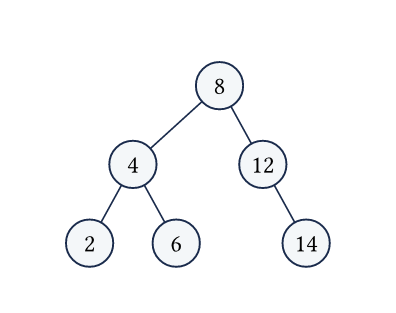
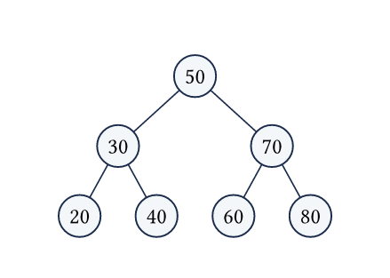
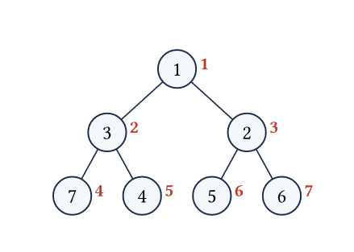
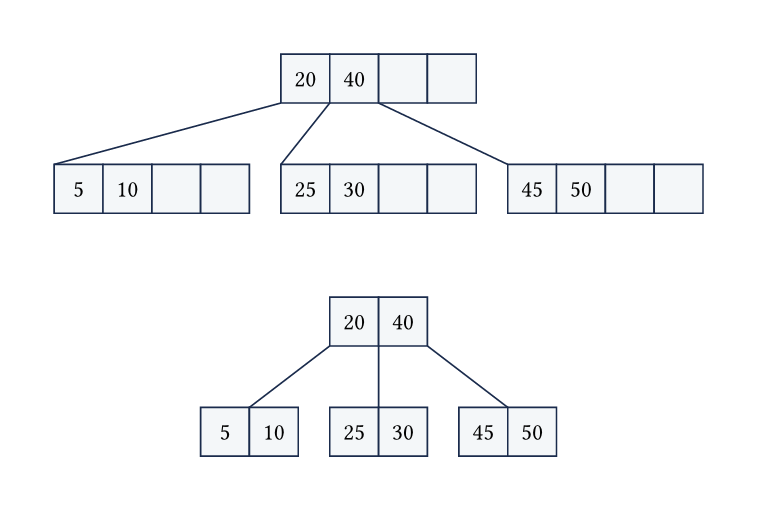
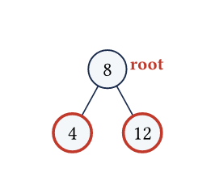

[](https://github.com/revo2123/sapling)
[](LICENSE)

# sapling
A small and simple Typst library for creating **computer science tree structures**.

## Features
- **Binary (Search) Trees**
- **AVL Trees** (with balance factors)
- **Heaps** (with optional indices)
- **Treaps** (with or without parenthesis)
- **B-Trees** (with anchor modes)
- Marking and annotating nodes
- Walkthroughs to show how a tree changes, step by step

## Usage
```typ
#import "@preview/sapling:0.1.0": *

#binary-tree((8, (4, 2, 6), (12, none, 14)))
#avl-tree(bst-from((5, 3, 8, 1, 4)))
#heap((9, 7, 8, 3, 4))
#b-tree(((20,), (5, 10), (25, 30)), slots: 4)
```

## Examples

### Binary trees
A node is `(label, left, right)`, and a leaf can be just its label. Use `none` for a missing child.

```typ
#binary-tree((8, (4, 2, 6), (12, none, 14)))
```



### Binary search trees
`bst-from` builds a tree by inserting the values one after another.

```typ
#binary-tree(bst-from((50, 30, 70, 20, 40, 60, 80)))
```



### AVL trees
`avl-tree` works like `binary-tree` and adds balance factors. Unbalanced nodes are red. Use `bf: "lr"` to flip the sign convention or `bf: none` to hide the factors.

```typ
#avl-tree(bst-from((10, 5, 20, 15, 30, 17)))
```


### Heaps
`heap` takes an array in level order. Use `indices: 0` or `indices: 1` to show the array index at each node.

```typ
#heap((1, 3, 2, 7, 4, 5, 6), indices: 1)
```



### Treaps
A node is `(key, priority, left, right)`. Use `parens: true` to show `(key,priority)`.

```typ
#treap((50, 90, (30, 70), (70, 80, (60, 10), (80, 5))))
#treap((50, 90, (30, 70), (70, 80, (60, 10), (80, 5))), parens: true)
```


### B-trees
A leaf is an array of keys, and an inner node is `(keys, child1, child2, ...)`. `slots` fixes the number of cells per node, and `anchor` sets where edges end on a child: `"left"` (default) or `"center"`.

```typ
#b-tree(((20, 40), (5, 10), (25, 30), (45, 50)), slots: 4)
#b-tree(((20, 40), (5, 10), (25, 30), (45, 50)), anchor: "center")
```



### Marking and annotating nodes
`marked` highlights keys in every tree type. For binary trees, `node` can also highlight a single node with `mark` or annotate it with `extra`.

```typ
#binary-tree(
  node(8, node(4, mark: true), node(12), extra: "root"),
  marked: (12,),
)
```



### Walkthroughs
Use `walkthrough` and `snapshot` to go through an entire solution. Each `snapshot` is one labelled state of a tree, and `walkthrough` places them side by side.

```typ
#walkthrough(
  snapshot("1) insert 7", b-tree((3, 5, 7), slots: 4)),
  snapshot("2) insert 9", b-tree((3, 5, 7, 9), slots: 4)),
  snapshot("3) insert 11 (split)", b-tree(((7,), (3, 5), (9, 11)), slots: 4)),
)
```


## License
MIT, see [LICENSE](LICENSE).
